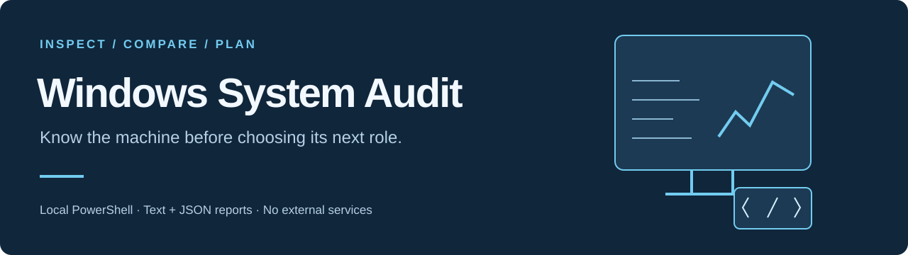

# Windows System Audit

A simple, local-first PowerShell script that generates a structured system report for a Windows machine.

This project is designed to help you quickly understand hardware capabilities and determine whether a PC is better suited for:

- Development / personal use
- Local AI agent hosting (OpenClaw, Ollama, etc.)

No external services. No dependencies. Fully local.

---

> [!NOTE]
> **A machine-planning utility, not a security assessment.** It collects local system information and uses simple role-scoring heuristics. It does not measure actual language-model performance or certify that a machine is ready for deployment.

[Run the script](#how-to-run) · [Collected fields](#what-it-collects) · [Report formats](#output-files) · [Compare PCs](#how-to-use-this-for-dual-pc-setup) · [Privacy](#security-considerations) · [Limits](#limitations)

## Purpose

This script collects structured system information and outputs:

1. A human-readable `.txt` report  
2. A structured `.json` report for automation or ingestion into other systems  

It is specifically useful for:

- Comparing multiple machines  
- Planning a dual-PC architecture (Control PC + Agent PC)  
- Validating GPU readiness for local AI workloads  
- Verifying WSL, NVIDIA, and storage performance  

---

## What It Collects

The report covers hardware, operating system, storage, networking, development tools and a simple suggested role. Expand the inventory below for individual fields.

<details>
<summary><strong>Full collection inventory</strong></summary>


### System
- Manufacturer  
- Model  
- System type  
- Total physical memory  
- Current user  

### Operating System
- Windows version  
- Build number  
- Architecture  
- Install date  
- Last boot time  

### BIOS & Motherboard
- BIOS version and release date  
- Motherboard manufacturer and model  

### CPU
- Model  
- Core count  
- Thread count  
- Clock speed  
- Cache sizes  

### Memory (RAM)
- Total installed RAM  
- Individual module details  
- Speed and configuration  

### GPU
- GPU model(s)  
- Driver version  
- VRAM  
- Status  

### Storage
- Physical disks (NVMe, SSD, HDD)  
- Bus type  
- Capacity  
- Health status  

### Logical Drives
- Drive usage  
- Free space  
- File system  

### Network
- Network adapters  
- Link speed  
- MAC address  

### WSL (Windows Subsystem for Linux)
- WSL status  
- Installed distributions  

### NVIDIA
- `nvidia-smi` output  
- GPU readiness for compute workloads  

### Disk Performance
- Basic WinSAT disk benchmark  

### System State
- Running services  
- Recent Windows updates (hotfixes)  

### Role Assessment
- GPU presence  
- NVMe presence  
- RAM size  
- CPU cores  
- Simple scoring system  
- Recommendation:
  - Agent PC candidate  
  - Dev / Personal PC candidate  

---

</details>

## Output Files

The script creates two files in `Desktop\SystemAudit` by default (or the specified directory):

```

SYSTEMNAME_system_audit_TIMESTAMP.txt
SYSTEMNAME_system_audit_TIMESTAMP.json

```

### TXT Report
Human-readable, organized by sections  

### JSON Report
Structured output for:
- automation  
- dashboards  
- ingestion into your own systems  

---

## How to Run

### 1. Open PowerShell as Administrator

### 2. Allow script execution for this session

```powershell
Set-ExecutionPolicy -Scope Process Bypass
```

### 3. Run the script

```powershell
.\full_system_audit.ps1
```

### Optional: Custom output directory

```powershell
.\full_system_audit.ps1 -OutputDirectory "C:\SystemAudit"
```

---

## Requirements

* Windows 10 or Windows 11
* PowerShell 5.1+ or PowerShell 7+
* Administrator privileges (recommended)

Optional but relevant:

* NVIDIA GPU for AI workloads
* WSL2 for Linux-based tooling

---

## How to Use This for Dual-PC Setup

Run the script on both machines and compare:

### Key Decision Factors

| Component | Why It Matters                                 |
| --------- | ---------------------------------------------- |
| GPU       | Determines local model size and performance    |
| RAM       | Controls concurrency and agent stability       |
| CPU       | Handles orchestration and background workloads |
| Storage   | Affects load times, indexing, and logging      |
| NVMe      | Critical for high I/O workloads                |
| WSL       | Needed for Linux-based tooling                 |
| NVIDIA    | Required for GPU acceleration                  |

---

## Recommended Role Assignment

### Agent PC (Execution Machine)

Should have:

* NVIDIA GPU (working with `nvidia-smi`)
* 32 GB RAM minimum (64 GB preferred)
* NVMe SSD
* 8+ CPU cores

This machine runs:

* OpenClaw
* Ollama
* Local LLMs
* Agent workflows
* Task execution

---

### Dev / Control PC

Should have:

* Stable performance
* Enough RAM for browser + tools
* Reliable network connection

This machine handles:

* Dashboard
* Monitoring
* Approvals
* Logs
* Development

---

## Optional dual-PC architecture concept

The following is a possible environment to plan with the report. The audit script does not install an agent, API, dashboard or network connection.

```
[ Dev / Control PC ]
        |
        |  (LAN only)
        v
[ Agent PC ]
```

* No internet required after setup
* No direct interaction with Agent PC required
* Control happens via local API or dashboard

---

## Security Considerations

**The reports can contain sensitive machine details**, including the current user, system name, MAC addresses, service inventory and configuration. Collection stays local; review and redact the TXT and JSON files before sharing them or committing anything to Git. Local storage is not encryption or automatic redaction.

If using the system for autonomous agents:

* Use a dedicated user account on the Agent PC
* Restrict file system access to a workspace directory
* Block unnecessary outbound traffic
* Avoid running agents as Administrator
* Log all actions locally

---

## Limitations

* WinSAT is a basic benchmark, not a full performance test
* GPU memory reporting via WMI can be inaccurate on some systems
* Does not test actual LLM performance
* Does not validate CUDA or model loading directly

---

## Future Improvements (Optional)

* Add CUDA verification checks
* Add Ollama health check
* Add network latency test between machines
* Add disk IOPS benchmarking
* Add live monitoring mode

---

## License

MIT License. See [LICENSE](LICENSE).
